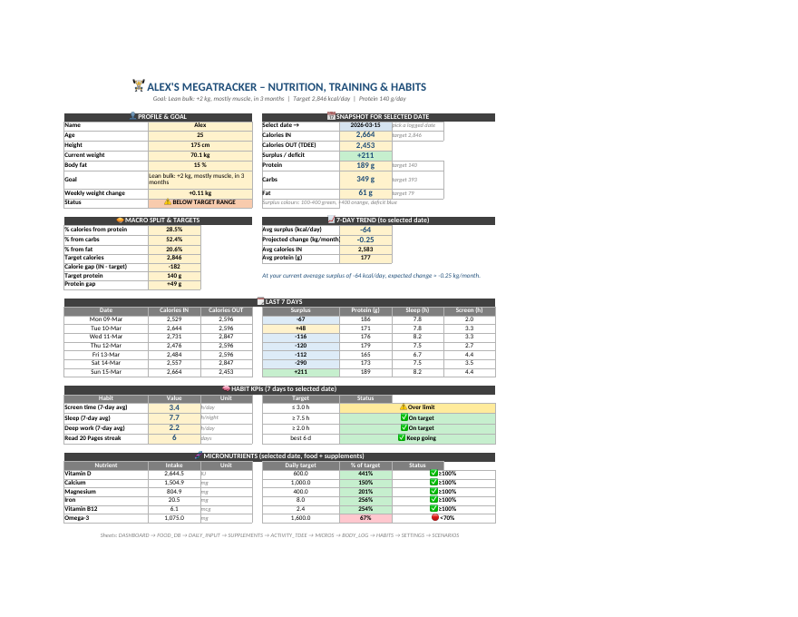
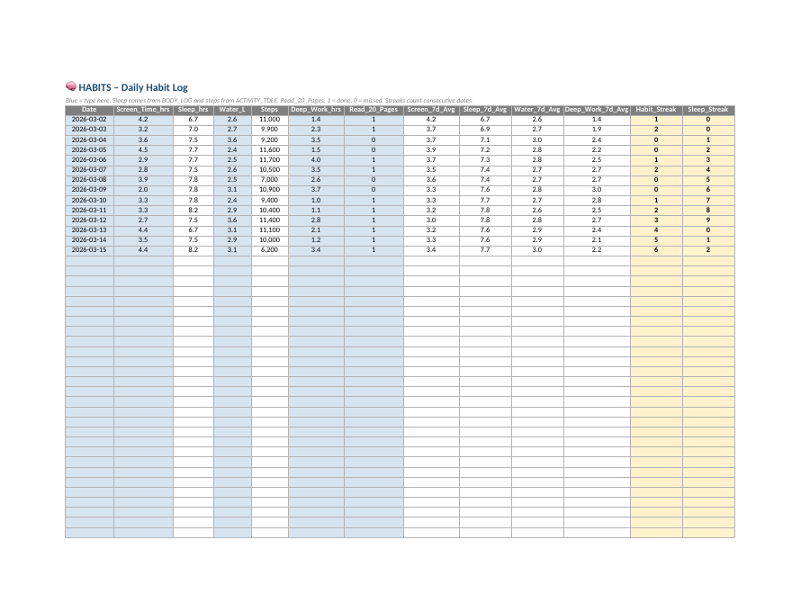
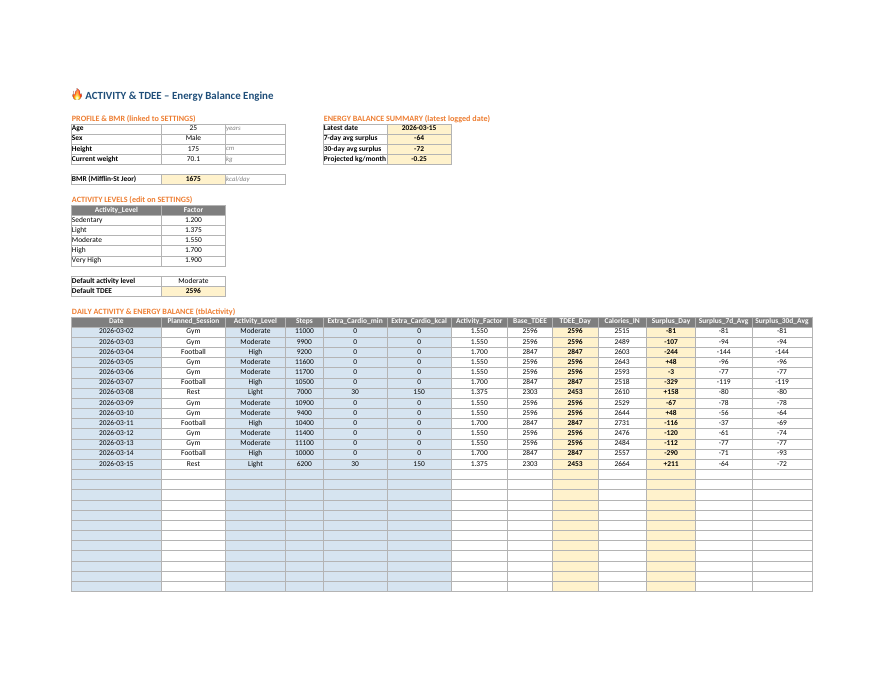
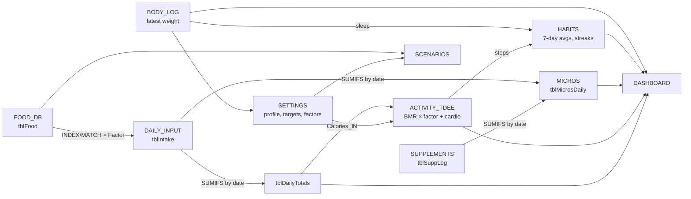

# MegaTracker

A formula-driven Excel workbook for tracking nutrition, training, body stats and daily habits. It is generated by Python from one YAML file.


You type food, weigh-ins, activity and habits into blue cells. Formulas work out the rest: calories, macros, micronutrients, TDEE, surplus, projected weight change, 7-day averages and habit streaks. There is no VBA and nothing is pasted in as a fixed value.



## What it tracks

- **Food:** every item you eat, scaled from a food database per 100 g, per 100 ml or per unit.
- **Macros and fibre:** per item, per day, and against targets set from your bodyweight.
- **Micronutrients:** vitamin D, calcium, magnesium, iron, B12 and omega-3, from food plus supplements, as a % of a daily target.
- **Supplements:** a master list and a daily dose log.
- **Activity and TDEE:** BMR (Mifflin-St Jeor), an activity factor per day, steps, extra cardio, your planned gym or sport session, and the daily surplus with 7-day and 30-day averages.
- **Body:** weight, measurements, sleep, stress, a 7-day average weight and the weekly change.
- **Habits:** screen time, sleep, water, steps, deep work/study hours and one custom yes/no habit, with 7-day averages and streaks.
- **Scenarios:** a what-if sandbox. Change portions and see calories, macros, surplus and kg/month.

## Screenshots

| Habits log | Activity and TDEE |
|---|---|
|  |  |

The screenshots come from `examples/MegaTracker_sample.xlsx`, which holds 14 days of demo data for a sample profile. LibreOffice rendered them.

## Quickstart

```bash
pip install -r requirements.txt
cp config.example.yaml config.yaml   # then edit your profile, goals, foods and habits
python build.py                      # writes output/MegaTracker.xlsx
```

Options:

```bash
python build.py --config config.yaml --out output/MegaTracker.xlsx
python build.py --sample-days 0      # empty template, no demo rows
```

`config.yaml` is git-ignored, so your personal numbers stay on your machine. Any key you leave out falls back to `config.example.yaml`.

## Sheets

| Sheet | What it does |
|---|---|
| `DASHBOARD` | Pick a date. The dashboard shows your profile and goal status, the day's calories in and out with the surplus, the macro split against targets, the 7-day trend with projected kg/month, a last-7-days table, habit KPIs (screen time, sleep, deep work, streak) and micronutrient coverage. Colour rules flag the surplus range, on-track status and % of target. |
| `FOOD_DB` | `tblFood`: the master food table. The Unit_Type column says how the other values scale. It has spare blue rows for new foods. |
| `DAILY_INPUT` | `tblIntake`: one row per item eaten, with a `Factor` column and scaled macros and micros. `tblDailyTotals` (columns U-Z) adds up each date with `SUMIFS`. The per-row micronutrient columns are grouped; click `+` to show them. |
| `SUPPLEMENTS` | `tblSuppMaster` (what each dose contains) and `tblSuppLog` (what you took each day). |
| `ACTIVITY_TDEE` | Profile and BMR, the activity factors, and `tblActivity`: planned session (from the weekly schedule), activity level, steps, cardio, TDEE, calories in, surplus, and 7-day and 30-day averages. |
| `MICROS` | `tblRDA` holds your daily targets. `tblMicrosDaily` gives food + supplements = total and % of target for each date. |
| `BODY_LOG` | `tblBody`: weigh-ins, measurements, sleep, recovery, a 7-day average weight, and the weekly change (this week's average minus last week's). |
| `HABITS` | `tblHabits` (new): screen time, water, deep work and a custom 1/0 habit. Sleep and steps are pulled in from `BODY_LOG` and `ACTIVITY_TDEE`, so you never type them twice. It also has 7-day averages, a habit streak and a sleep-target streak. |
| `SETTINGS` | The one place for constants: profile, goal, macro targets, activity factors, BMR/TDEE, daily targets, weekly training schedule, habit targets and the colour legend. |
| `SCENARIOS` | A what-if day: foods × grams × servings, an activity level and a sport-day toggle. It gives the surplus and kg/month, plus a one-sentence summary. |

Colour code: **light blue** cells are inputs, **white** cells are formulas, **light yellow** cells are key results, and header rows are **grey with white text**.

## How the formulas chain



Key formulas:

- **Factor:** `Amount / 100` for `per_100g` and `per_100ml`, and `Amount / Unit_Grams` for `per_unit`. Every nutrient is then `INDEX(tblFood[col], MATCH(Food_ID, tblFood[Food_ID], 0)) × Factor`.
- **BMR:** `10 × kg + 6.25 × cm − 5 × age + 5` (male) or `− 161` (female). Current weight is the latest `BODY_LOG` weigh-in.
- **TDEE for a day:** `BMR × activity factor + extra cardio kcal`. **Surplus** = calories in − TDEE.
- **Projection:** `average 7-day surplus × 30 / 7700` kg per month.
- **7-day averages** use `AVERAGEIFS` over dates in `(date − 7, date]`, so a skipped day doesn't shift the window.
- **Streaks:** `IF(done = 1, IF(previous row is yesterday, previous streak + 1, 1), 0)`.

All risky formulas are wrapped in `IFERROR`. The workbook uses functions that Excel 2010+, LibreOffice and Google Sheets all support: INDEX/MATCH, SUMIFS, AVERAGEIFS and LOOKUP.

## Customise

- **Add a food:** add a row to `foods:` in `config.yaml` and rebuild, or type it into a blank blue row on `FOOD_DB`. Values are per 100 g, per 100 ml, or per unit of `Unit_Grams`.
- **Change your custom habit:** set `habits.custom_habit` (for example `No_Phone_After_10pm`) and rebuild. The HABITS column and the dashboard KPI are renamed.
- **Habit targets:** `screen_time_max_hrs`, `sleep_min_hrs`, `water_min_l` and `deep_work_min_hrs` drive the dashboard's status column.
- **Training:** `training.schedule` sets the planned session for each weekday. `activity_levels` sets the factors.
- **Goal:** for a cut, set a negative `calorie_surplus_kcal` and negative `weekly_change_min_kg`/`max_kg`.
- **Capacity:** `layout.intake_rows` and `layout.day_rows` control how many rows have formulas ready.

## Project layout

```
build.py                 entry point
config.example.yaml      sample profile, foods, supplements, schedule, habits
megatracker/
  workbook.py            creates the sheets and runs the builders in dependency order
  styles.py              fonts, fills, borders, table/validation helpers
  settings.py food_db.py daily_input.py supplements.py activity_tdee.py
  micros.py body_log.py habits.py scenarios.py dashboard.py
  sample_data.py         deterministic demo rows
  config.py              loads YAML on top of the example
scripts/verify.py        checks sheets and formula text (used in CI)
examples/MegaTracker_sample.xlsx
```

## Built with AI

I designed this with AI assistance. I wrote a detailed spec (sheets, tables, formulas and style rules), then used Claude Code and Google Antigravity to generate and refine the Python builders. The restructure into a package, the YAML config, the HABITS sheet and the formula fixes were also done with Claude Code. I reviewed every formula chain and checked the sample workbook in a spreadsheet app.

## Author

Kaushik G L ([@Kaushik05code](https://github.com/Kaushik05code)). MIT licensed; see [LICENSE](LICENSE).
